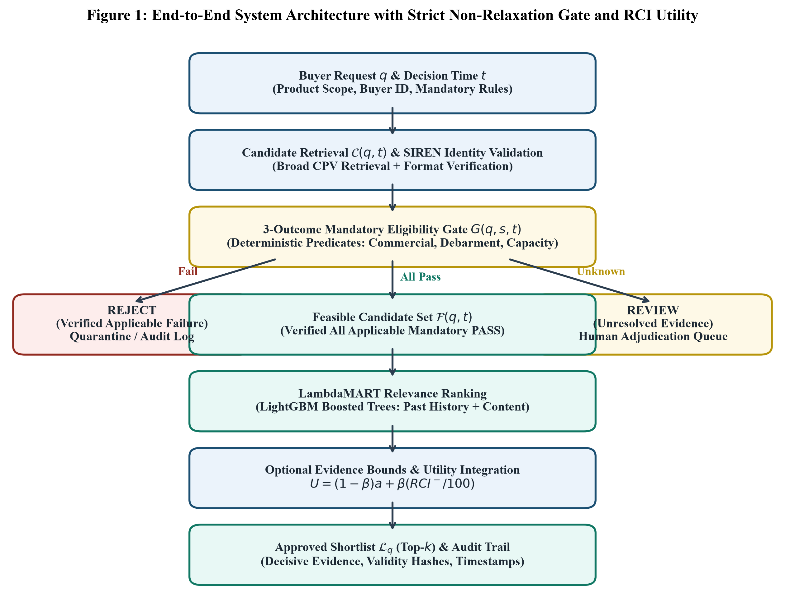

<div align="center">

# Evidence-Aware, Compliance-Constrained Learning-to-Rank

### Auditable B2B supplier matching that treats legal eligibility as a hard constraint—not another ranking feature

[](https://www.python.org/)
[](https://lightgbm.readthedocs.io/)
[](LICENSE)
[](#reproduce-the-study)

**Research code, frozen datasets, experiment outputs, audit evidence, and publication figures for compliance-aware supplier recommendation.**

</div>



## Why this repository exists

Conventional supplier rankers learn from historical contract awards. That can reproduce commercial relevance, but it can also place dissolved, disqualified, or insufficiently verified suppliers at the top of a shortlist.

This project separates those responsibilities:

1. retrieve plausible candidates;
2. verify identity and mandatory evidence;
3. route each candidate to `ELIGIBLE`, `REVIEW`, or `REJECT`;
4. rank only the verified feasible set with LambdaMART;
5. optionally blend relevance with a conservative lower-bound Regulatory Compatibility Index (RCI).

The key invariant is simple: **missing mandatory evidence never becomes an automatic pass, and the system never weakens the gate to fill a top-k list.**

## Results at a glance

| Evaluation | Result |
|---|---:|
| Locked test partition | 1,333 queries / 34,926 candidate pairs |
| Unconstrained LambdaMART NDCG@10 | 0.7897 |
| Gate + LambdaMART + RCI NDCG@10 | 0.6222 |
| Proposed Recall@10 | 0.7447 |
| False clearance rate | **0.0%** |
| Failure detection recall | **100.0%** |
| Unsafe `UNKNOWN -> PASS` false clearance rate | 14.85% |

The lower observed-award NDCG is deliberate: the constrained system refuses to reproduce historical awards when required evidence is failed or unresolved. See [`experiments/metrics/`](experiments/metrics/) for the frozen outputs and [`deliverables/limitations_log.md`](deliverables/limitations_log.md) for the interpretation boundaries.

## What is included

```text
.
├── data/
│   ├── raw/                  # TenderKG, Spanish BOE, and Latvian source data
│   ├── processed/            # Relational tables and ranking datasets
│   └── splits/               # Parent-tender chronological partition
├── deliverables/             # Manifests, schemas, rubric, lineage, config, citation data
├── experiments/
│   ├── logs/                 # Learning curves
│   ├── metrics/              # Audits, baselines, bootstrap CIs, ablations
│   └── predictions/          # Locked test predictions
├── figures/                  # Reproducible vector and 300-DPI figures
└── src/
    ├── acquisition/          # Downloads and checksum verification
    ├── audits/               # Dataset forensic audits
    ├── preprocessing/        # Tables, splits, candidates, and temporal features
    ├── models/               # Mandatory gate, RCI, utility, numerical checks
    ├── evaluation/           # Training, evaluation, bootstrap, and figures
    └── utils/                # Research/publication support utilities
```

Private publication assets are intentionally absent: no author photos or biographies, Word documents, manuscript PDFs, manuscript page renders, or IEEE Access templates are tracked. The root `.gitignore` enforces the same boundary for future commits.

## Reproduce the study

Run commands from the repository root with Python 3.12.

```powershell
python -m venv .venv
.\.venv\Scripts\Activate.ps1
python -m pip install --upgrade pip
python -m pip install -r deliverables\requirements.lock
```

### 1. Verify mathematical and policy invariants

```powershell
python -m src.models.numerical_checks
```

This checks the three-outcome gate, non-relaxation, RCI bounds, integrated utility, LambdaRank pairwise gradients, and monotonicity.

### 2. Verify raw datasets

The frozen raw files are included. To download them again and verify their recorded hashes:

```powershell
python -m src.acquisition.download_datasets
python -m src.audits.audit_tenderkg
python -m src.audits.audit_boe
python -m src.audits.audit_latvian
```

### 3. Rebuild tables and chronological splits

```powershell
python -m src.preprocessing.build_splits_and_tables
python -m src.preprocessing.build_ranking_dataset
```

Features for a query at time `t` are constructed only from events before `t`; sibling lots stay with their parent tender across the 60/20/20 chronological split.

### 4. Train and evaluate

```powershell
python -m src.evaluation.run_experiments
python -m src.evaluation.generate_figures
```

The evaluation suite trains LambdaMART, compares nine ranking variants, calculates macro ranking metrics, performs 2,000 parent-tender bootstrap resamples, evaluates cold-start subgroups, runs ablations, and exports structured results.

## Core policy model

For mandatory rules, the gate is non-compensatory:

| Evidence state | Decision | Automated ranking? |
|---|---|---:|
| Any verified mandatory failure | `REJECT` | No |
| No failure, but evidence/applicability unresolved | `REVIEW` | No |
| Every applicable mandatory rule verified | `ELIGIBLE` | Yes |

Optional evidence is represented as an interval rather than forced into a point estimate:

```text
RCI− = 100 Σ wⱼlⱼ       RCI+ = 100 Σ wⱼuⱼ
U(q,s) = (1 − β)a(q,s) + β·RCI−(q,s)/100
```

Missing optional evidence receives `[0, 1]`; weights are not renormalized around missing observations. This preserves uncertainty and guarantees non-negative marginal utility for improved verified evidence when `β, wⱼ >= 0`.

## Research artifacts

- [`dataset_manifest.json`](deliverables/dataset_manifest.json): source URLs, versions, licenses, sizes, MD5, and SHA-256 hashes.
- [`data_dictionary.csv`](deliverables/data_dictionary.csv): relational schema and missing-value semantics.
- [`feature_lineage.csv`](deliverables/feature_lineage.csv): feature provenance and availability conditions.
- [`split_manifest.csv`](deliverables/split_manifest.csv): immutable parent-tender assignment.
- [`annotation_rubric.md`](deliverables/annotation_rubric.md): human adjudication rules.
- [`evidence_ledger.md`](deliverables/evidence_ledger.md): research-question-to-result traceability.
- [`limitations_log.md`](deliverables/limitations_log.md): dataset, legal, and generalization boundaries.
- [`model_config.yaml`](deliverables/model_config.yaml): frozen LambdaMART and policy configuration.

## Scope and responsible use

This is a research prototype, not a legal determination service. A valid identifier format is not proof of current legal standing; RCI bounds are evidence-completeness intervals, not probabilities; and results measured on French public procurement data do not transfer automatically to other jurisdictions. Human review remains mandatory for unresolved evidence.

## Data licenses

The MIT license covers this repository's original code only. Bundled datasets retain their source licenses:

| Dataset | License |
|---|---|
| TenderKG v1 | CC BY 4.0 |
| Spanish BOE v3 | CC0 1.0 Universal |
| Latvian Procurement Validation Dataset | CC BY-NC-SA 4.0 |
| INSEE Sirene metadata/endpoints | Open Licence 2.0 |

See the machine-readable [`dataset_manifest.json`](deliverables/dataset_manifest.json) before redistributing data.


## License

Original code is released under the [MIT License](LICENSE). Third-party data is governed by the licenses listed above.
